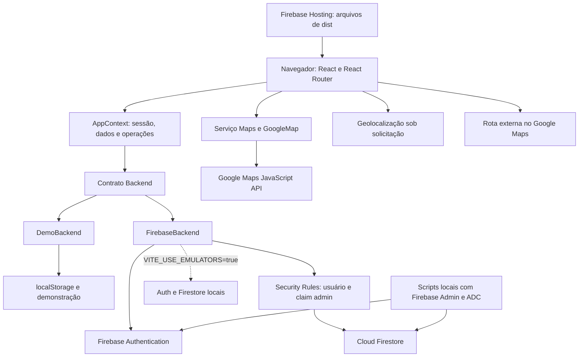
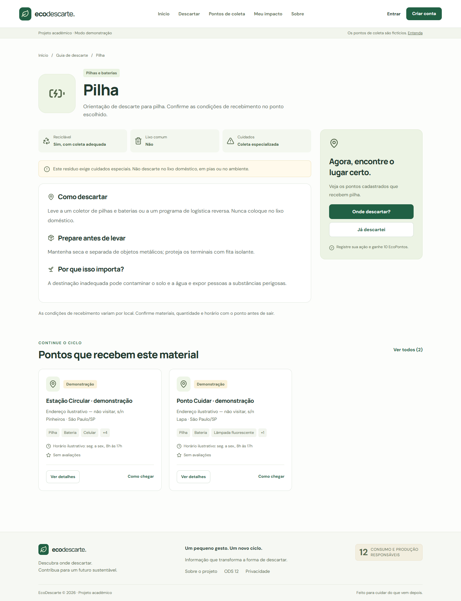
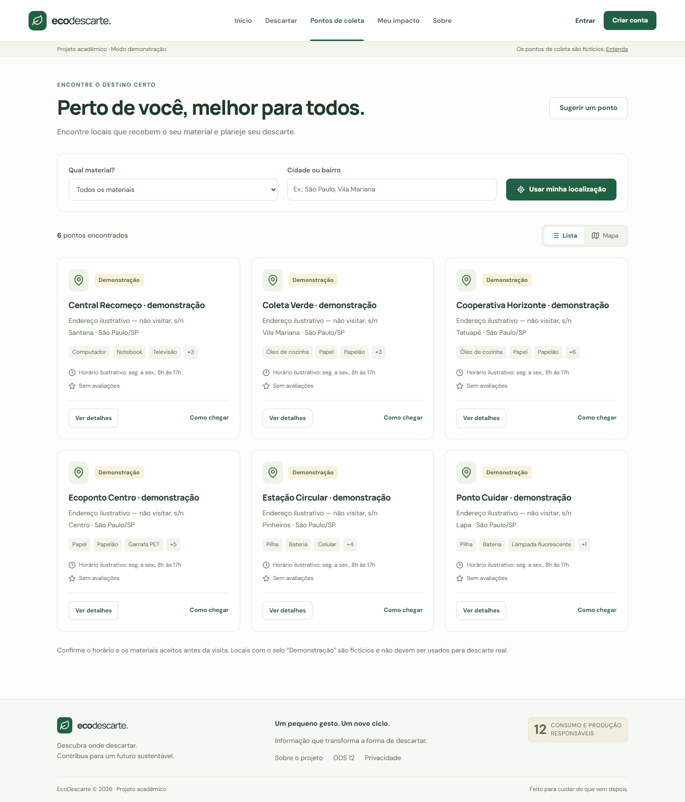
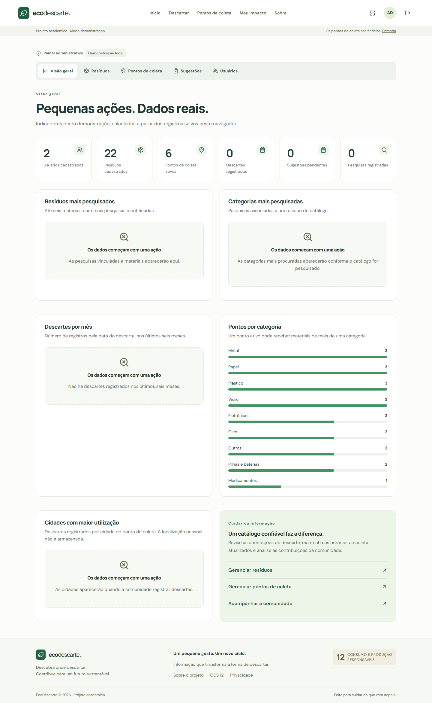

# ♻️ EcoDescarte

**PEQUENAS ATITUDES, GRANDES MUDANÇAS**


O **EcoDescarte** é uma aplicação web acadêmica que reúne orientações sobre resíduos, pontos de coleta e participação comunitária. Desenvolvida com React, TypeScript e Firebase, relaciona-se à **ODS 12 — Consumo e Produção Responsáveis** da Organização das Nações Unidas.

O percurso central é descobrir como preparar um material, encontrar um ponto compatível e consultar como chegar. Contas autenticadas podem registrar descartes, sugerir locais e confirmar informações; administradores mantêm o catálogo e analisam sugestões.

> A base inicial contém **22 resíduos e 6 pontos de coleta fictícios**, identificados como demonstração. Não se desloque até esses marcadores. Uma operação real exige curadoria dos estabelecimentos e configuração dos serviços externos.

Documentação revisada em **17 de outubro de 2026**, a partir do código e das configurações locais. Integração implementada e configuração de publicação não comprovam funcionamento ou deploy remoto. Não há licença definida no repositório; os badges não representam certificação nem resultado de testes.

## Sumário

- [Sobre o projeto](#sobre-o-projeto)
- [Relação com a ODS 12](#ods-12)
- [Problema identificado](#problema)
- [Solução tecnológica](#solucao)
- [Funcionalidades e rotas](#funcionalidades)
- [Formulário de sugestão de ponto](#formulario)
- [Tecnologias utilizadas](#tecnologias)
- [Arquitetura do sistema](#arquitetura)
- [Estrutura de diretórios](#diretorios)
- [Banco de dados, regras e índices](#banco)
- [Autenticação e autorização](#autenticacao)
- [Instalação e execução local](#instalacao)
- [Variáveis de ambiente](#ambiente)
- [Configuração do Firebase e emuladores](#firebase)
- [Popular o banco de dados](#seed)
- [Configuração de administrador](#administrador)
- [Integração com Google Maps](#google-maps)
- [Pontos reais e manutenção do catálogo](#pontos-reais)
- [EcoPontos e gamificação](#ecopontos)
- [Testes e qualidade](#testes)
- [Build de produção](#build)
- [Publicação e atualização no Firebase Hosting](#publicacao)
- [Segurança e privacidade](#seguranca)
- [Limitações atuais](#limitacoes)
- [Melhorias futuras](#melhorias)
- [Capturas de tela](#capturas)
- [Autores e informações acadêmicas](#autores)
- [Referências](#referencias)

<a id="sobre-o-projeto"></a>

## Sobre o projeto

A proposta nasce de um problema cotidiano: ter um resíduo em mãos e não saber como destiná-lo. O EcoDescarte organiza informações sobre classificação, preparação e recebimento em um fluxo acessível para cidadãos, estudantes e pessoas interessadas em descarte responsável.

O projeto foi concebido como uma solução acadêmica de Tecnologia da Informação vinculada à sustentabilidade. Cooperativas, estabelecimentos com logística reversa, escolas e prefeituras são possíveis parceiros de uma implantação futura; o repositório não comprova parcerias existentes.

A contribuição imediata é informacional: reduzir a dificuldade de localizar orientações e contatos adequados. Reciclagem realizada, redução de resíduos e benefícios ambientais dependem de adoção, rede confiável e avaliação em campo. Os indicadores do sistema não comprovam esses impactos.

<a id="ods-12"></a>

## Relação com a ODS 12

Os Objetivos de Desenvolvimento Sustentável integram a Agenda 2030 da ONU e abordam desafios sociais, econômicos e ambientais. A ODS 12 trata de padrões sustentáveis de consumo e produção. Ela foi escolhida porque decisões sobre uso, reaproveitamento e destinação de materiais exigem informação acessível. Consulte a [ONU Brasil](https://brasil.un.org/pt-br/sdgs/12) e as [metas oficiais](https://sdgs.un.org/goals/goal12).

| Meta                                                                                        | Relação proposta pelo EcoDescarte                                                                                      |
| ------------------------------------------------------------------------------------------- | ---------------------------------------------------------------------------------------------------------------------- |
| **12.5** — redução da geração de resíduos por prevenção, redução, reciclagem e reutilização | Orientações sobre materiais e pontos compatíveis podem apoiar a destinação; a aplicação não mede toneladas recicladas. |
| **12.8** — acesso à informação e conscientização para modos de vida sustentáveis            | Guia pesquisável, páginas educativas e informações de coleta tornam o tema mais acessível.                             |

Essa relação é uma justificativa de projeto, não uma declaração de cumprimento das metas da ONU.

<a id="problema"></a>

## Problema identificado

Informações dispersas dificultam reconhecer a categoria de um resíduo, sua reciclabilidade e os cuidados necessários. Eletrônicos, pilhas, baterias, lâmpadas e medicamentos podem exigir recebimento especializado ou logística reversa; óleo de cozinha e embalagens também dependem de preparação e condições locais.

Outro obstáculo é localizar estabelecimentos que realmente recebam o material. Um ponto não aceita necessariamente todas as categorias. Endereço, horários, restrições e materiais precisam ser confirmados e atualizados. O catálogo educativo não substitui a informação do operador nem as regras locais aplicáveis.

<a id="solucao"></a>

## Solução tecnológica

**Usuário → Pesquisa do resíduo → Orientação → Pontos compatíveis → Mapa e rota → Descarte adequado.**

O visitante consulta o catálogo sem conta. A busca considera nomes e sinônimos e apresenta preparação, riscos e locais compatíveis. Localização autorizada ou endereço informado podem ajudar a ordenar os pontos por proximidade.

Depois de realizar a ação fora da plataforma, o usuário autenticado pode registrar o descarte e acompanhar seu histórico. Também pode indicar locais para análise administrativa e avaliar informações de pontos existentes. A aplicação não agenda coleta nem confirma fisicamente o recebimento.

<a id="funcionalidades"></a>

## Funcionalidades e rotas

### Visitantes

- Página inicial com pesquisa, sugestões de busca, categorias e explicação do fluxo.
- Busca por nome e sinônimos, normalização de acentos/maiúsculas e tolerância limitada a erros de digitação; filtro por categoria.
- Guia com descrição, reciclabilidade, perigo, lixo comum, preparação, orientação e impacto ambiental descrito no catálogo.
- Pontos ativos filtrados por material e texto de cidade/bairro; endereço, materiais, horários, contato, verificação administrativa e avaliação agregada.
- Lista e mapa, marcadores, geolocalização opcional, distância em linha reta e rotas externas.
- Busca de proximidade por endereço quando Maps está configurado.
- Páginas Sobre, ODS 12, seção de privacidade em Sobre e página 404.
- Estados de carregamento, erro e ausência de resultados; alternativa em lista quando o mapa falha.

### Usuários autenticados

- Cadastro com nome, e-mail, senha e confirmação; login e logout.
- Recuperação de senha pelo Firebase. O modo demo informa que não envia e-mail nem altera senhas.
- Perfil com edição do nome, data de cadastro, estatísticas, nível e EcoPontos. Foto é exibida se disponível, mas não há upload na interface.
- Descarte com resíduo ativo, ponto compatível, quantidade inteira de 1 a 100.000 e data válida desde 2000 até hoje, referenciada em Brasília.
- Histórico de descartes e sugestões, incluindo andamento e motivo de rejeição.
- Sugestão de novos pontos para análise.
- Avaliação de 1 a 5, comentário opcional e confirmação explícita das informações: uma contribuição por usuário/ponto.

### Administradores

- Dashboard com usuários, resíduos, pontos ativos, descartes, sugestões pendentes e pesquisas.
- Gráficos simples de resíduos/categorias pesquisados, descartes dos últimos seis meses, pontos por categoria e cidades dos pontos com descartes.
- Cadastro, edição, desativação e reativação de resíduos e pontos, com confirmação da mudança de status.
- Aprovação de sugestões com coordenadas confirmadas ou rejeição com motivo.
- Consulta de usuários por nome/e-mail e perfil, com indicadores individuais. Essa tela não promove administradores nem exclui contas.

Os gráficos usam os dados carregados. Uma pesquisa é associada ao primeiro resultado encontrado, quando houver, e não é uma medição independente de impacto. Cidades são derivadas dos pontos dos descartes, não da localização pessoal.

### Rotas implementadas

| Acesso        | Rotas                                      | Conteúdo                                                 |
| ------------- | ------------------------------------------ | -------------------------------------------------------- |
| Público       | `/`                                        | Início                                                   |
| Público       | `/descartar`, `/residuos/:id`              | Pesquisa e guia                                          |
| Público       | `/pontos`, `/mapa`, `/pontos/:id`          | Lista, mapa e detalhes                                   |
| Público       | `/entrar`, `/cadastro`, `/recuperar-senha` | Autenticação                                             |
| Usuário       | `/perfil`, `/meu-impacto`                  | Mesma página de perfil                                   |
| Usuário       | `/historico`, `/registrar-descarte`        | Histórico e registro                                     |
| Usuário       | `/sugerir-ponto`, `/ecopontos`             | Sugestões e gamificação                                  |
| Público       | `/sobre`, `/ods-12`                        | Contexto educativo                                       |
| Administrador | `/admin`, `/admin/dashboard`               | Mesmo dashboard                                          |
| Administrador | `/admin/residuos`, `/admin/pontos`         | Catálogos                                                |
| Administrador | `/admin/sugestoes`, `/admin/usuarios`      | Moderação e comunidade                                   |
| Público       | Rota não reconhecida                       | 404; `/admin/*` tem estado próprio de seção desconhecida |

Parâmetros incluem `q` e `categoria` na pesquisa, `residuo` na lista de pontos e `waste`/`point` no registro de descarte. Exemplo: `/descartar?q=pilha`.

<a id="formulario"></a>

## Formulário de sugestão de ponto de coleta

O formulário está em [UserPages.tsx](src/pages/UserPages.tsx), com sanitização e validação específicas em [validation.ts](src/services/validation.ts). Digitação e colagem passam por campos controlados; o formulário valida antes do envio e os serviços demo/Firebase repetem `validateSuggestion` antes da criação.

| Campo               | Regra atual                                                                                    | Mensagem específica                                     |
| ------------------- | ---------------------------------------------------------------------------------------------- | ------------------------------------------------------- |
| Nome do local       | Obrigatório; letras latinas básicas, acentos previstos no código e espaços; até 120 caracteres | `Use apenas letras no nome do local.`                   |
| Endereço            | Obrigatório; letras e espaços, sem número do imóvel; até 160 caracteres                        | `Use apenas letras no endereço.`                        |
| Número              | Obrigatório; de 1 a 6 dígitos; sem `S/N`, letras, sinais ou espaços                            | `Informe apenas números.`                               |
| Bairro              | Obrigatório; letras e espaços; até 80 caracteres                                               | `Use apenas letras no bairro.`                          |
| CEP                 | Obrigatório; exatamente 8 dígitos, sem máscara no valor salvo                                  | `Informe um CEP com 8 números.`                         |
| Cidade              | Obrigatória; letras e espaços; até 80 caracteres                                               | `Use apenas letras no nome da cidade.`                  |
| Estado              | Seleção obrigatória de uma das 27 UFs; serviço verifica duas letras maiúsculas                 | Validação nativa; serviço: `Informe a sigla do estado.` |
| Materiais recebidos | Pelo menos um resíduo ativo nos checkboxes                                                     | `Selecione ao menos um material recebido pelo local.`   |
| Horário             | Selects **Abre às** e **Fecha às**, com 48 opções de `00:00` a `23:30`                         | `Selecione um horário de funcionamento válido.`         |
| Telefone            | Opcional; quando preenchido, 10 ou 11 dígitos com DDD                                          | `Informe um telefone com DDD e 10 ou 11 números.`       |
| Observações         | Opcional; texto livre, até 1.000 caracteres na interface                                       | Limite do textarea; números e pontuação permitidos      |

Os acentos aceitos são `ÀÁÂÃÉÊÍÓÔÕÚÜÇ` e suas versões minúsculas. A sanitização normaliza acentos, remove caracteres incompatíveis, reduz espaços repetidos e aplica limites. No envio, remove espaços nas extremidades. Campos obrigatórios vazios também recebem validação nativa do navegador.

Exemplos: `Belo123 Horizonte` torna-se `Belo Horizonte`; `31abc99999-8888` torna-se `31999998888`. CEP e telefone têm validação de formato/comprimento, sem consulta da existência do CEP, validade do DDD ou titularidade da linha.

Horários não aceitam texto livre. O fechamento deve ser posterior à abertura no mesmo dia; intervalos iguais, invertidos ou incompletos são recusados. O campo `openingHours` continua uma string, como `08:00 - 18:00`. Não há calendário, horários por dia, feriados ou funcionamento após a meia-noite.

### Aprovação e compatibilidade

1. Usuário autenticado envia a sugestão como `PENDENTE`.
2. Autor e administração podem consultá-la; ela ainda não aparece publicamente.
3. Administrador confirma informações e coordenadas para aprovar, ou informa o motivo para rejeitar.
4. Aprovação cria `collectionPoints/suggestion_<id-da-sugestao>` e marca `APROVADO` na mesma transação Firebase. Rejeição marca `REJEITADO` sem criar ponto.
5. Aprovação gera 30 EcoPontos para o autor. Uma sugestão já analisada não pode ser moderada novamente pelo fluxo existente.

Essas restrições são das **novas sugestões**. O cadastro administrativo de pontos mantém regras próprias, incluindo horário livre e número `S/N`; documentos antigos não foram migrados. As Security Rules verificam autorização e integridade, mas **não reproduzem todas as novas restrições do formulário**, como somente letras e intervalos de meia hora. Validação no navegador não é uma barreira de segurança do servidor.

<a id="tecnologias"></a>

## Tecnologias utilizadas

Versões resolvidas em [pnpm-lock.yaml](pnpm-lock.yaml). O [package.json](package.json) declara faixas, que podem resolver versões diferentes em uma instalação nova com npm. O projeto está na versão `1.0.0`, com `private: true`.

| Tecnologia/pacote               | Versão no lockfile             | Finalidade                                   |
| ------------------------------- | ------------------------------ | -------------------------------------------- |
| React / React DOM               | 19.3.0                         | Interface e renderização                     |
| TypeScript                      | 5.8.3                          | Tipagem estrita                              |
| Vite / `@vitejs/plugin-react`   | 6.4.3 / 4.7.0                  | Desenvolvimento e build                      |
| React Router DOM                | 7.18.4                         | Rotas                                        |
| HTML5 e CSS                     | Sem versão de pacote           | Semântica, estilos e responsividade          |
| Firebase SDK Web                | 12.19.0                        | Integrações no navegador                     |
| Firebase Authentication         | Serviço Firebase               | Contas, sessão e recuperação                 |
| Cloud Firestore                 | Serviço Firebase               | Documentos, transações e regras              |
| Firebase Hosting                | Configurado em `firebase.json` | Hospedagem estática                          |
| Google Maps JavaScript API      | Canal `weekly`                 | Mapa, marcadores e geocodificação            |
| `@googlemaps/js-api-loader`     | 2.1.3                          | Carregamento das bibliotecas Maps            |
| Lucide React                    | 0.468.0                        | Ícones                                       |
| Firebase Admin SDK              | 13.10.0                        | Manutenção privilegiada e integração emulada |
| Firebase CLI (`firebase-tools`) | 14.27.0                        | Emuladores e publicação                      |
| Vitest                          | 3.2.7                          | Testes de domínio, serviços e validações     |
| `@firebase/rules-unit-testing`  | 5.0.2                          | Testes das regras                            |
| Playwright Test                 | 1.63.0                         | Testes de navegador                          |
| `@axe-core/playwright`          | 4.13.0                         | Acessibilidade automática                    |
| `tsx`                           | 4.23.15                        | Execução dos scripts TypeScript              |
| Prettier                        | 3.9.9                          | Formatação                                   |

Também há tipos para React, React DOM, Node.js e Google Maps. Não há uso implementado de Firebase Storage, Cloud Functions, Google Analytics, Google Places, login Google, biblioteca de gráficos ou servidor HTTP próprio.

<a id="arquitetura"></a>

## Arquitetura do sistema

A aplicação é uma SPA: o navegador renderiza React e React Router resolve as rotas. `AppContext` centraliza dados, sessão, carregamento, erros e operações. O contrato `Backend` permite alternar entre `DemoBackend` e `FirebaseBackend`.



- **Apresentação:** páginas, componentes, CSS e administração carregada por importação dinâmica.
- **Estado:** React Context e hooks; operações solicitam nova leitura. A sessão acompanha `onIdTokenChanged`; não há assinatura contínua `onSnapshot` de todas as coleções.
- **Persistência:** consultas filtram catálogo por `active` e contribuições por `userId` para usuários comuns. Administradores carregam o conjunto permitido. Timestamps são convertidos em strings ISO no cliente.
- **Integridade:** aprovação, descarte e avaliação usam transações; regras verificam permissões no banco.
- **Mapas:** independentes do modo de dados; uma chave Maps configurada também pode carregar o mapa em demo.

| Modo             | Seleção                                         | Persistência                                            |
| ---------------- | ----------------------------------------------- | ------------------------------------------------------- |
| Demo             | `demo`, ou `auto` sem configuração Firebase     | `localStorage`, chave `ecodescarte-demo-v1`             |
| Firebase remoto  | `firebase`, ou `auto` com configuração completa | Authentication e Firestore do projeto                   |
| Firebase emulado | Backend Firebase com `VITE_USE_EMULATORS=true`  | Auth em `127.0.0.1:9099`; Firestore em `127.0.0.1:8080` |

Configuração parcial gera erro, sem queda silenciosa para demo. A demonstração usa PBKDF2 com sal para senhas locais, mas dados e permissões continuam controláveis pelo navegador. Não há migração automática demo/Firebase. Consulte [ARQUITETURA.md](docs/ARQUITETURA.md).

<a id="diretorios"></a>

## Estrutura de diretórios

Arquivos de projeto, omitindo dependências, builds, caches e relatórios gerados:

```text
ecodescarte/
├── public/favicon.svg
├── src/
│   ├── App.tsx
│   ├── main.tsx
│   ├── components/
│   │   ├── Cards.tsx
│   │   ├── CategoryIcon.tsx
│   │   ├── GoogleMap.tsx
│   │   ├── Layout.tsx
│   │   ├── SearchBox.tsx
│   │   ├── UI.tsx
│   │   └── admin/
│   │       ├── AdminDashboard.tsx
│   │       ├── AdminFields.tsx
│   │       ├── AdminPoints.tsx
│   │       ├── AdminSuggestions.tsx
│   │       ├── AdminUsers.tsx
│   │       ├── AdminWastes.tsx
│   │       └── admin.css
│   ├── config/firebase.ts
│   ├── contexts/AppContext.tsx
│   ├── data/seed.ts
│   ├── hooks/useLocation.ts
│   ├── pages/
│   │   ├── AboutPages.tsx
│   │   ├── AdminPages.tsx
│   │   ├── AuthPages.tsx
│   │   ├── HomePage.tsx
│   │   ├── PointPages.tsx
│   │   ├── UserPages.tsx
│   │   └── WastePages.tsx
│   ├── services/
│   │   ├── backend.ts
│   │   ├── demo.ts
│   │   ├── firebase.ts
│   │   ├── maps.ts
│   │   └── validation.ts
│   ├── styles/global.css
│   ├── types/index.ts
│   └── utils/domain.ts
├── scripts/
│   ├── seed.ts
│   └── set-admin.ts
├── tests/
│   ├── domain.test.ts
│   ├── service.demo.test.ts
│   ├── validation.suggestion.test.ts
│   ├── firestore.rules.test.ts
│   ├── firebase.integration.test.ts
│   ├── e2e/
│   │   ├── accessibility.spec.ts
│   │   ├── admin.spec.ts
│   │   ├── public.spec.ts
│   │   ├── suggestion.spec.ts
│   │   └── user-flows.spec.ts
│   └── failures/
│       ├── firebase.spec.ts
│       └── maps.spec.ts
├── docs/
│   ├── APRESENTACAO.md
│   ├── ARQUITETURA.md
│   ├── TESTES.md
│   └── screenshots/
├── .env.example
├── .gitignore
├── .prettierignore
├── .prettierrc.json
├── firebase.json
├── firestore.rules
├── firestore.indexes.json
├── index.html
├── package.json
├── pnpm-lock.yaml
├── pnpm-workspace.yaml
├── playwright.config.ts
├── playwright.failures.config.ts
├── tsconfig.json
├── vite.config.ts
└── README.md
```

`pages` implementa fluxos; `components` reúne elementos visuais; `services` concentra dados e validações; `utils/domain.ts` contém busca, distâncias e EcoPontos. `types` define contratos, `data/seed.ts` contém a base inicial e `scripts` executa manutenção privilegiada. `.env` é local e ignorado pelo Git.

<a id="banco"></a>

## Banco de dados, regras e índices

São sete coleções no banco Firestore padrão, sem subcoleções no modelo atual. IDs dos documentos são expostos como `id` no cliente, sem um campo `id` adicional persistido. Relações são IDs em strings, não `DocumentReference`.

`createdAt`, `updatedAt` e `reviewedAt` são **Timestamp** no Firestore e strings ISO no cliente; gravações do navegador usam timestamps do servidor. `disposals.date` é string `AAAA-MM-DD`. Os exemplos JSON usam strings ISO para representar timestamps de forma legível e **não são arquivos prontos de importação**. Todos os dados abaixo são fictícios.

### `users/{uid}`

| Campos                      | Tipos e finalidade                                          |
| --------------------------- | ----------------------------------------------------------- |
| `name`, `email`, `photoURL` | Strings do perfil; foto pode estar vazia                    |
| `role`                      | String `user` ou `admin`, usada na apresentação do cadastro |
| `createdAt`                 | Timestamp de criação                                        |

ID igual ao UID Authentication. Cadastro cria o perfil; interface permite editar o nome. Usuário lê seu perfil e pode atualizar apenas `name`/`photoURL` nas regras; administração lê todos. Não há exclusão pelo cliente. Senha, EcoPontos e nível não são campos dessa coleção. Autorização usa a claim, não `users.role`.

```json
{
  "name": "Participante Exemplo",
  "email": "participante@example.com",
  "role": "user",
  "photoURL": "",
  "createdAt": "2026-10-01T12:00:00.000Z"
}
```

### `wastes/{wasteId}`

| Campos                                                                      | Tipos e finalidade                         |
| --------------------------------------------------------------------------- | ------------------------------------------ |
| `name`, `normalizedName`, `category`                                        | Strings de nome, busca e categoria         |
| `synonyms`                                                                  | Lista de strings                           |
| `description`, `disposalInstructions`, `preparation`, `environmentalImpact` | Strings educativas                         |
| `recyclable`, `dangerous`, `commonTrash`, `active`                          | Booleanos                                  |
| `icon`, `image`                                                             | Strings; imagem é URL opcional, sem upload |
| `createdAt`, `updatedAt`                                                    | Timestamps                                 |

Administradores criam/editam; desativação altera `active`, sem apagar. Leitura pública somente de ativos. Pontos, descartes e métricas referenciam esses IDs. Categorias: Eletrônicos, Papel, Plástico, Vidro, Metal, Pilhas e baterias, Óleo, Medicamentos e Outros.

```json
{
  "name": "Pilha",
  "normalizedName": "pilha",
  "synonyms": ["pilhas", "bateria"],
  "category": "Pilhas e baterias",
  "description": "Exemplo educativo de resíduo que exige destinação específica.",
  "recyclable": true,
  "dangerous": true,
  "commonTrash": false,
  "disposalInstructions": "Confirme o recebimento em um ponto especializado.",
  "preparation": "Siga as orientações do operador local.",
  "environmentalImpact": "O descarte inadequado pode contaminar o ambiente.",
  "icon": "Pilhas e baterias",
  "image": "",
  "active": true,
  "createdAt": "2026-10-01T12:00:00.000Z",
  "updatedAt": "2026-10-01T12:00:00.000Z"
}
```

### `collectionPoints/{pointId}`

| Campos                                                                             | Tipos e finalidade                                                      |
| ---------------------------------------------------------------------------------- | ----------------------------------------------------------------------- |
| `name`, `description`, `address`, `number`, `district`, `city`, `state`, `zipCode` | Strings de identificação/endereço; número e CEP não são tipos numéricos |
| `lat`, `lng`                                                                       | Números em graus decimais                                               |
| `phone`, `website`, `openingHours`                                                 | Strings de contato e horário                                            |
| `acceptedWasteIds`                                                                 | Lista de IDs de resíduos                                                |
| `verified`, `active`, `demo`                                                       | Booleanos de curadoria, disponibilidade e demonstração                  |
| `rating`, `totalReviews`                                                           | Média numérica e contagem inteira                                       |
| `createdAt`, `updatedAt`                                                           | Timestamps                                                              |

Administradores criam/editam/desativam; aprovação também cria ponto. Leitura pública exige `active=true`, não `verified=true`: verificação é independente da visibilidade. Avaliações atualizam média/contagem em transação; edição administrativa preserva esses agregados. Não há exclusão pelo cliente.

```json
{
  "name": "Ponto Exemplo Fictício",
  "description": "Registro ilustrativo; não representa atendimento real.",
  "address": "Rua Exemplo",
  "number": "123",
  "district": "Bairro Exemplo",
  "city": "Cidade Exemplo",
  "state": "SP",
  "zipCode": "00000000",
  "lat": -23.55,
  "lng": -46.63,
  "phone": "",
  "website": "",
  "openingHours": "08:00 - 18:00",
  "acceptedWasteIds": ["pilha"],
  "verified": false,
  "active": true,
  "rating": 0,
  "totalReviews": 0,
  "demo": true,
  "createdAt": "2026-10-01T12:00:00.000Z",
  "updatedAt": "2026-10-01T12:00:00.000Z"
}
```

### `suggestions/{suggestionId}`

| Campos                                                                                                      | Tipos e finalidade                                |
| ----------------------------------------------------------------------------------------------------------- | ------------------------------------------------- |
| `userId`                                                                                                    | String com UID do autor                           |
| `name`, `address`, `number`, `district`, `city`, `state`, `zipCode`, `openingHours`, `phone`, `observation` | Strings do formulário                             |
| `acceptedWasteIds`                                                                                          | Lista de IDs de resíduos                          |
| `status`                                                                                                    | `PENDENTE`, `APROVADO` ou `REJEITADO`             |
| `createdAt`, `reviewedAt`                                                                                   | Timestamps; análise é opcional antes da moderação |
| `pointId`, `rejectionReason`                                                                                | Strings opcionais, conforme resultado             |

Autor cria e lê suas sugestões; administrador lê e analisa. Autor não edita/exclui o envio. Transição somente a partir de `PENDENTE`; aprovação exige criação atômica do ponto associado.

```json
{
  "userId": "uid-exemplo",
  "name": "Ecoponto Exemplo",
  "address": "Rua Exemplo",
  "number": "123",
  "district": "Centro",
  "city": "Cidade Exemplo",
  "state": "SP",
  "zipCode": "00000000",
  "acceptedWasteIds": ["pilha"],
  "openingHours": "08:00 - 18:00",
  "phone": "",
  "observation": "Exemplo fictício. Entrada pela portaria 2.",
  "status": "PENDENTE",
  "createdAt": "2026-10-01T12:00:00.000Z"
}
```

### `disposals/{disposalId}`

`userId`, `wasteId`, `collectionPointId` e `date` são strings; `quantity` é inteiro positivo; `createdAt` é Timestamp. Relaciona usuário, resíduo e ponto. Autor cria/consulta; administradores consultam todos. Resíduo/ponto devem estar ativos e compatíveis; data entre 2000 e hoje, quantidade de 1–100.000. Registros são imutáveis pelo cliente.

```json
{
  "userId": "uid-exemplo",
  "wasteId": "pilha",
  "collectionPointId": "ponto-exemplo",
  "quantity": 4,
  "date": "2026-10-01",
  "createdAt": "2026-10-01T12:00:00.000Z"
}
```

### `reviews/{uid_pointId}`

`userId`, `pointId` e `comment` são strings; `rating` é inteiro de 1 a 5; `confirmed` é booleano verdadeiro; `createdAt` é Timestamp. O ID `${uid}_${pointId}` limita a uma avaliação por par. Criação é atômica com agregados do ponto ativo; comentário até 1.000 caracteres. Autor/admin leem; sem atualização/exclusão. O público vê média, não uma lista pública de comentários.

```json
{
  "userId": "uid-exemplo",
  "pointId": "ponto-exemplo",
  "rating": 5,
  "confirmed": true,
  "comment": "Informações conferidas no cenário fictício.",
  "createdAt": "2026-10-01T12:00:00.000Z"
}
```

### `searchLogs/{searchId}`

`term` é string não vazia de até 120 caracteres; `wasteId`/`userId` são strings ou `null`; `createdAt` é Timestamp. Visitante registra `userId=null`; usuário registra seu UID. `wasteId` identifica o primeiro resultado ativo ou é nulo. Somente administradores leem. Sem edição/exclusão; falhas de métricas não bloqueiam a busca.

```json
{
  "term": "pilha",
  "wasteId": "pilha",
  "userId": null,
  "createdAt": "2026-10-01T12:00:00.000Z"
}
```

### Security Rules e índices

[firestore.rules](firestore.rules) nega acessos não previstos, limita campos/tipos, verifica proprietário e claim administrativa, impede autopromoção e restringe transições/agregados. Nenhuma coleção permite exclusão pelo cliente. Scripts com Admin SDK não são limitados por essas regras.

[firestore.indexes.json](firestore.indexes.json) contém `indexes: []` e `fieldOverrides: []`: **nenhum índice composto personalizado** está declarado. Consultas usam igualdade simples (`active` ou `userId`); busca, ordenação e agregações são locais. Futuras consultas podem exigir índices adicionais. Regras não filtram resultados automaticamente: consultas precisam respeitar seus critérios. [Security Rules](https://firebase.google.com/docs/firestore/security/get-started).

<a id="autenticacao"></a>

## Autenticação e autorização

Cadastro cria conta de e-mail/senha no Authentication, perfil `users/{uid}` como `user` e nome de exibição. Formulário exige senha de pelo menos oito caracteres e confirmação. Login usa `signInWithEmailAndPassword`, logout `signOut`, recuperação `sendPasswordResetEmail`. Não há login Google, verificação obrigatória de e-mail ou gerenciamento de múltiplos fatores.

Páginas pessoais exigem autenticação; administração redireciona visitantes e recusa usuários sem perfil administrativo. Login pode preservar a rota pretendida. Proteção de navegação complementa as regras do banco.

`FirebaseBackend.getUser()` deriva o perfil da **claim `admin=true` no ID token**. Alterar `role` no frontend ou em um documento não concede autorização. Em demo, botões de acesso servem para percorrer fluxos locais.

Perfil permite editar o nome; não oferece alteração de e-mail, exclusão de conta, upload de foto ou promoção de permissões. Referências: [autenticação por senha](https://firebase.google.com/docs/auth/web/password-auth) e [custom claims](https://firebase.google.com/docs/auth/admin/custom-claims).

<a id="instalacao"></a>

## Instalação e execução local

### Pré-requisitos

- **Node.js:** recomenda-se a linha **24, versão 24.15.0 ou posterior dentro dessa linha**. Não há `engines`, `.nvmrc` ou `.node-version` próprio no projeto. Dependências transitivas do lockfile, como `node-gyp` e `re2`, declaram `^22.22.2 || ^24.15.0 || >=26.0.0`; portanto “qualquer Node 22” não descreve corretamente a instalação. O runtime desta revisão é 24.21.0; isso não equivale a novos testes.
- **pnpm 10.x** para o lockfile versão 9, ou **npm** distribuído com Node.js. Não há campo `packageManager` fixando a versão do gerenciador.
- Navegador atual e rede para instalar dependências e usar serviços externos.
- **Java 21** no `PATH` para os emuladores Firestore; dispensável na demonstração comum.
- Projeto Firebase/chave Maps apenas para as respectivas integrações.

### Com pnpm

Na pasta obtida ao clonar ou extrair o repositório:

```bash
cd ecodescarte
pnpm install --frozen-lockfile
pnpm dev
```

Pule `cd ecodescarte` se já estiver nessa pasta. `pnpm-workspace.yaml` permite o script de instalação do esbuild e desabilita os de `@firebase/util`, `protobufjs` e `re2`. Não é necessário atualizar dependências para executar o projeto.

### Com npm

```bash
cd ecodescarte
npm install
npm run dev
```

Os scripts são compatíveis com npm, mas ele não utiliza `pnpm-lock.yaml`: pode gerar `package-lock.json` e resolver versões diferentes nas faixas declaradas. `npm ci` não é a opção inicial, pois não há `package-lock.json`. Evite alternar gerenciadores na mesma instalação.

Servidor normalmente em `http://127.0.0.1:5173`; siga a URL do terminal. Sem configuração Firebase, `auto` inicia demo. Se já houver `.env` configurado e quiser somente demonstrar, use `VITE_DATA_MODE=demo` e reinicie.

Em **Entrar**, escolha **Entrar como usuário demo**, **Admin demo** ou cadastre dados de teste. O armazenamento depende do navegador e da origem: `localhost`, `127.0.0.1` e portas diferentes não compartilham necessariamente os registros.

Para reiniciar uma demonstração própria, remova somente `ecodescarte-demo-v1` nas ferramentas de armazenamento e recarregue. Isso remove contas/contribuições locais daquela origem; preserve dados necessários antes. Não afeta nem importa dados Firebase.

<a id="ambiente"></a>

## Variáveis de ambiente

Copie [.env.example](.env.example) para `.env`. Use `Copy-Item .env.example .env` no PowerShell ou `cp .env.example .env` em Unix **somente se o destino ainda não existir**; preserve configurações locais já preenchidas.

```dotenv
VITE_FIREBASE_API_KEY=
VITE_FIREBASE_AUTH_DOMAIN=
VITE_FIREBASE_PROJECT_ID=
VITE_FIREBASE_STORAGE_BUCKET=
VITE_FIREBASE_MESSAGING_SENDER_ID=
VITE_FIREBASE_APP_ID=
VITE_GOOGLE_MAPS_API_KEY=
VITE_DATA_MODE=auto
VITE_USE_EMULATORS=false
```

| Variável                            | Finalidade                                                                           |
| ----------------------------------- | ------------------------------------------------------------------------------------ |
| `VITE_FIREBASE_API_KEY`             | Configuração web Firebase; obrigatória no modo Firebase                              |
| `VITE_FIREBASE_AUTH_DOMAIN`         | Domínio de autenticação do app Web; obrigatório                                      |
| `VITE_FIREBASE_PROJECT_ID`          | Identificador do projeto, não nome de exibição; obrigatório                          |
| `VITE_FIREBASE_STORAGE_BUCKET`      | Campo opcional; não ativa upload/Storage                                             |
| `VITE_FIREBASE_MESSAGING_SENDER_ID` | Campo opcional; não ativa notificações                                               |
| `VITE_FIREBASE_APP_ID`              | ID do app Web; obrigatório                                                           |
| `VITE_GOOGLE_MAPS_API_KEY`          | Chave de navegador Maps; sem ela, lista e rotas externas continuam disponíveis       |
| `VITE_DATA_MODE`                    | `auto` por padrão; `demo` força dados locais; `firebase` exige configuração completa |
| `VITE_USE_EMULATORS`                | Somente `true` conecta Auth/Firestore locais; padrão `false`                         |

Em `auto`, qualquer configuração Firebase presente faz o sistema exigir as quatro variáveis obrigatórias. Configuração parcial e modo inválido geram erro.

**Variáveis `VITE_` podem aparecer no bundle do navegador.** Configuração web Firebase não é conta de serviço administrativa. Não coloque chaves privadas, tokens ou JSON de conta de serviço nessas variáveis ou no GitHub. Chave de navegador Maps precisa de restrições de domínio/APIs. Reinicie Vite após alterar `.env` e gere novo build para publicar mudanças de ambiente.

Variáveis de manutenção, definidas no terminal: `GOOGLE_APPLICATION_CREDENTIALS` indica credenciais administrativas; `GCLOUD_PROJECT` é alternativa ao argumento de projeto; `FIRESTORE_EMULATOR_HOST` e `FIREBASE_AUTH_EMULATOR_HOST` direcionam ferramentas aos emuladores. Não usam prefixo `VITE_`.

<a id="firebase"></a>

## Configuração do Firebase e emuladores

### Projeto remoto

1. No [console Firebase](https://console.firebase.google.com/), crie/selecione o projeto e registre um **app Web**. Analytics é opcional e não é integrado pelo código.
2. Preencha `.env` com a configuração web; use `VITE_DATA_MODE=firebase` e `VITE_USE_EMULATORS=false`.
3. Em **Authentication → Sign-in method**, habilite **E-mail/senha**.
4. Em **Authentication → Settings → Authorized domains**, confira hosts de desenvolvimento e domínio final. Não presuma autorização automática de `localhost`. Revise o modelo de e-mail de recuperação.
5. Crie o **Cloud Firestore padrão**, escolhendo a região. O código usa `getFirestore(app)` sem banco alternativo. Não deixe regras abertas em ambiente público.
6. Na raiz do projeto, autentique a CLI e publique regras/índices:

```bash
npx firebase login
npx firebase deploy --only "firestore:rules,firestore:indexes" --project SEU_PROJECT_ID
```

7. Inicie a aplicação e crie uma conta no projeto destinado à validação. Confira login, perfil e logout. Com um administrador configurado, cadastre dados de teste ou utilize conscientemente o seed; valide descartes, sugestões e permissões.
8. Teste recuperação em uma caixa de e-mail autorizada. Esses testes remotos criam registros/enviam e-mail e não foram executados nesta revisão documental.

Não é necessário recriar arquivos com `firebase init`: configurações já existem. Sem `.firebaserc` versionado, os exemplos sempre indicam `--project`. Referências: [configuração Web](https://firebase.google.com/docs/web/setup) e [Firestore](https://firebase.google.com/docs/firestore/quickstart).

### Emuladores locais

Em um terminal com Java 21:

```bash
npx firebase emulators:start --only "auth,firestore" --project demo-ecodescarte
```

| Serviço                  | Endereço                |
| ------------------------ | ----------------------- |
| Authentication           | `http://127.0.0.1:9099` |
| Firestore                | `127.0.0.1:8080`        |
| Interface dos emuladores | `http://127.0.0.1:4000` |

Configuração exclusivamente de teste, com o mesmo projeto da CLI:

```dotenv
VITE_DATA_MODE=firebase
VITE_USE_EMULATORS=true
VITE_FIREBASE_API_KEY=demo-key-only
VITE_FIREBASE_AUTH_DOMAIN=demo-ecodescarte.firebaseapp.com
VITE_FIREBASE_PROJECT_ID=demo-ecodescarte
VITE_FIREBASE_APP_ID=1:123:web:demo
VITE_FIREBASE_STORAGE_BUCKET=
VITE_FIREBASE_MESSAGING_SENDER_ID=
VITE_GOOGLE_MAPS_API_KEY=
```

São valores fictícios. Reinicie Vite e mantenha emuladores ativos. Conexões são fixadas em `127.0.0.1`, pressupondo navegador e emuladores na mesma máquina. O comando não configura persistência automática entre reinicializações. Testes podem limpar dados emulados; separe-os de históricos de apresentação. [Emulator Suite](https://firebase.google.com/docs/emulator-suite/install_and_configure).

<a id="seed"></a>

## Popular o banco de dados

[scripts/seed.ts](scripts/seed.ts) cria **22 resíduos e 6 pontos fictícios**, definidos em [src/data/seed.ts](src/data/seed.ts), usando Firebase Admin. Não cria contas Authentication nem usuários remotos; contas dos botões demo são locais.

`DocumentReference.create()` preserva IDs já existentes sem sobrescrita. Não há atualização automática nem opção de importar somente resíduos. Para uma base exclusivamente real, considere cadastrar o catálogo pela administração em vez do seed completo.

### Credenciais e execução remota

Use Application Default Credentials (ADC), por exemplo uma conta de serviço autorizada, guardada **fora do repositório**. Login da CLI Firebase não substitui necessariamente as ADC usadas pelos scripts. [Configuração do Admin SDK](https://firebase.google.com/docs/admin/setup).

PowerShell, com caminho ilustrativo a substituir:

```powershell
$env:GOOGLE_APPLICATION_CREDENTIALS = 'C:\credenciais-fora-do-repositorio\conta-servico.json'
npm run seed -- --project=SEU_PROJECT_ID --confirm-write
```

Em Unix, configure `export GOOGLE_APPLICATION_CREDENTIALS="/caminho/fora/do/repositorio/conta-servico.json"`. Projeto vem de `--project=...` ou `GCLOUD_PROJECT`. Fora do emulador, `--confirm-write` é obrigatório. Esse comando **escreve no banco**; confira o destino.

### Execução no emulador

Com Firestore emulado ativo, em outro terminal PowerShell:

```powershell
$env:FIRESTORE_EMULATOR_HOST = '127.0.0.1:8080'
npm run seed -- --project=demo-ecodescarte
```

O seed emulado dispensa ADC e `--confirm-write`. Pontos continuam com `demo=true` mesmo em projeto remoto. Repetir preserva IDs existentes, mas pode recriar documentos apagados manualmente; não é mecanismo de atualização/migração.

<a id="administrador"></a>

## Configuração de administrador

1. Cadastre uma conta normal na aplicação.
2. Copie o UID em **Firebase Console → Authentication → Users**, ou na interface Auth do emulador.
3. Configure ADC em terminal confiável conforme a seção do seed.
4. Confira projeto/UID e execute:

```bash
npm run admin -- --project=SEU_PROJECT_ID --uid=UID_DO_USUARIO --confirm-write
```

Para revogar:

```bash
npm run admin -- --project=SEU_PROJECT_ID --uid=UID_DO_USUARIO --revoke --confirm-write
```

[set-admin.ts](scripts/set-admin.ts) adiciona/remove a claim `admin`, preserva outras claims, atualiza `users.role` se o perfil existir e revoga refresh tokens. A pessoa deve **sair e entrar novamente**. ID tokens já emitidos podem continuar válidos até expirar; não presuma invalidação instantânea de toda requisição antiga. [Custom claims](https://firebase.google.com/docs/auth/admin/custom-claims).

No emulador, configure **ambas** as variáveis e use UID emulado:

```powershell
$env:FIREBASE_AUTH_EMULATOR_HOST = '127.0.0.1:9099'
$env:FIRESTORE_EMULATOR_HOST = '127.0.0.1:8080'
npm run admin -- --project=demo-ecodescarte --uid=UID_DO_USUARIO --confirm-write
```

**Administrador exige `--confirm-write` também no emulador.** Para voltar ao remoto, abra outro terminal ou remova variáveis de emulador, evitando misturar destinos. Não exponha Admin SDK no frontend.

<a id="google-maps"></a>

## Integração com Google Maps

### Configuração

1. No Google Cloud, selecione projeto, configure faturamento quando exigido e habilite **Maps JavaScript API**.
2. Crie chave para navegador, restrita a **sites/referenciadores HTTP** e APIs necessárias.
3. Autorize somente origens usadas, como `http://127.0.0.1:5173/*`, `http://localhost:5173/*` e `https://SEU_DOMINIO/*`; inclua preview se necessário.
4. Preencha `VITE_GOOGLE_MAPS_API_KEY`, reinicie Vite ou gere novo build.
5. Para **Buscar proximidade por endereço**, habilite também **Geocoding API**. Ela é opcional para mapa básico e filtro local por cidade/bairro.

Referências: [chaves e restrições](https://developers.google.com/maps/documentation/javascript/get-api-key) e [geocodificação](https://developers.google.com/maps/documentation/javascript/geocoding). Consulte preços/cotas atuais; não há controle de orçamento implementado na aplicação.

### Comportamento

- Carregador `importLibrary`, idioma `pt-BR`, região `BR` e canal `weekly`.
- Marcadores avançados mostram nome, endereço, materiais, detalhes e rota. O código usa `mapId: 'DEMO_MAP_ID'`, sem variável para Map ID. Google permite esse ID para testes; avalie ID próprio antes de implantação definitiva. [Marcadores avançados](https://developers.google.com/maps/documentation/javascript/advanced-markers/start).
- Geolocalização após clique, sem acompanhamento contínuo; exige permissão e contexto seguro, como HTTPS ou localhost.
- Distância calculada por Haversine no cliente, **em linha reta**, não trajeto nem tempo de viagem.
- **Como chegar** abre URL Google Maps com destino, origem quando disponível e modo de direção. Não usa Directions API/Routes API; abrir Maps URLs não exige a chave de mapa. [URLs de rotas](https://developers.google.com/maps/documentation/urls/get-started).
- Sem chave ou com falha de carregamento/autorização, mostra mensagem e mantém lista/rotas. Há espera de até 12 segundos no carregamento e opção de tentar novamente quando aplicável.
- Localização negada preserva pesquisa/lista. Endereço geocodificado pode servir como referência sem gravar coordenadas pessoais no perfil.

Places e descoberta automática de estabelecimentos não são usados. O mapa apresenta os pontos do próprio catálogo, inclusive os fictícios ativos.

<a id="pontos-reais"></a>

## Pontos reais e manutenção do catálogo

Use **modo Firebase** e conta administradora para uma base compartilhada. Em demo, pontos criados continuam identificados como fictícios.

### Resíduos

Em `/admin/residuos`, crie/edite nome, sinônimos, categoria, descrição, instruções, preparação, impacto e indicadores de reciclabilidade/perigo/lixo comum. A interface recusa perigoso + lixo comum. Imagem é URL opcional, sem upload. Desativação/reativação preserva documentos e histórico.

### Pontos de coleta

1. Confirme existência e recebimento com estabelecimento, cooperativa, canal oficial de logística reversa ou prefeitura.
2. Em `/admin/pontos`, escolha **Novo ponto** ou edite um existente.
3. Preencha nome, descrição, logradouro, número, bairro, cidade/UF, CEP, horário, coordenadas e materiais. Contatos são opcionais. O formulário administrativo admite `S/N` e horário descritivo livre.
4. Confira coordenadas em graus decimais e materiais efetivamente aceitos; informe restrições na descrição.
5. Marque **Informações verificadas pela administração** somente após conferência. Em local real validado, desmarque **Ponto fictício / dado de demonstração**.
6. Salve e confira detalhes públicos, filtros e destino da rota.

Para substituir a base fictícia, prefira **desativar os seis pontos demo e cadastrar pontos reais novos**. Não basta retirar a identificação de demonstração de endereços inventados. Se adaptar um documento, substitua/verifique todos os dados relevantes e preserve coerência do histórico.

Não há exclusão definitiva na interface. Média e contagem de avaliações são preservadas nas edições. Revise horários e materiais periodicamente. O selo interno não representa certificação oficial.

<a id="ecopontos"></a>

## EcoPontos e gamificação

`userStats`, em [domain.ts](src/utils/domain.ts), calcula:

```text
EcoPontos = (registros de descarte × 10)
          + (sugestões aprovadas × 30)
          + (avaliações com confirmação × 5)
```

| Ação                  | Pontos | Condição                                       |
| --------------------- | ------ | ---------------------------------------------- |
| Registrar descarte    | +10    | Por registro; quantidade não multiplica pontos |
| Sugerir ponto         | +30    | Somente após aprovação                         |
| Confirmar informações | +5     | Uma avaliação confirmada por usuário/ponto     |

| Faixa   | Nível                 |
| ------- | --------------------- |
| 0–49    | Iniciante Sustentável |
| 50–149  | Reciclador Consciente |
| 150–299 | Guardião Verde        |
| 300–499 | Defensor do Planeta   |
| 500+    | Embaixador Eco        |

Perfil, histórico e página EcoPontos mostram progresso/próximo nível. Não há saldo `ecoPoints` editável nem campo `level` persistido em `users`. Não há resgate, prêmio financeiro ou ranking. Pontuação indica participação autorrelatada, não peso, destinação comprovada ou emissões evitadas.

<a id="testes"></a>

## Testes e qualidade

### Comandos existentes

Na raiz do projeto, após instalar dependências:

| Comando                          | Finalidade                                                                                                                          |
| -------------------------------- | ----------------------------------------------------------------------------------------------------------------------------------- |
| `npm test`                       | Vitest: domínio, demo e validações; regras excluídas sem variável de emulador; integração pulada sem os dois hosts locais esperados |
| `npm run test:e2e`               | Fluxos, formulário, responsividade e axe-core em `tests/e2e`                                                                        |
| `npm run test:failures`          | Maps indisponível e configuração Firebase incompleta; servidores 5176/5177                                                          |
| `npm run test:rules`             | Firestore emulado e testes de regras; exige Java                                                                                    |
| `npm run test:firebase`          | Auth/Firestore emulados e teste integrado                                                                                           |
| `npx tsc --noEmit`               | Verificação de tipos sem gerar a aplicação                                                                                          |
| `npm run build`                  | `tsc -b` seguido de `vite build`                                                                                                    |
| `npx prettier --check README.md` | Conferência deste documento                                                                                                         |
| `npm run format`                 | Reformata código, testes, scripts e documentação; modifica arquivos e não é teste                                                   |

Instale o navegador padrão:

```bash
npx playwright install chromium
```

Os testes E2E pressupõem **demo e ausência de chave Maps**. Feche servidor em 5173 com configuração diferente, pois Playwright pode reutilizá-lo. Use terminal dedicado, sem alterar `.env`:

```powershell
# PowerShell 7.5 ou posterior
$env:VITE_DATA_MODE = 'demo'
$env:VITE_GOOGLE_MAPS_API_KEY = ''
npm run test:e2e
npm run test:failures
```

O exemplo exige que a variável Maps permaneça definida com valor vazio. Esse comportamento é suportado a partir do [PowerShell 7.5](https://learn.microsoft.com/pt-br/powershell/module/microsoft.powershell.core/about/about_environment_variables?view=powershell-7.5); versões anteriores podem remover a variável e permitir que Vite carregue a chave existente em `.env`.

```bash
# Shell Unix
VITE_DATA_MODE=demo VITE_GOOGLE_MAPS_API_KEY='' npm run test:e2e
npm run test:failures
```

Para Chrome instalado, defina `PLAYWRIGHT_CHANNEL=chrome` no terminal. `E2E_BASE_URL` altera a URL do navegador, mas a configuração ainda prevê iniciar/verificar servidor em 5173; não a aponte para produção. E2E grava em contextos de navegador de teste; a suíte de sugestões também testa colagem com permissões de clipboard.

Emuladores de teste usam `demo-ecodescarte`, recriam documentos e, na integração, limpam contas emuladas. **Não use dados emulados que precise preservar nem variáveis apontando para um serviço remoto.** `test:rules` e `test:firebase` iniciam/encerram seus emuladores; deixe 8080/9099 disponíveis.

### Cobertura e resultados históricos

| Evidência                                                            | Resultado registrado                                                                                            | Limite                                                                 |
| -------------------------------------------------------------------- | --------------------------------------------------------------------------------------------------------------- | ---------------------------------------------------------------------- |
| [Relatório de 02/10/2026](docs/TESTES.md)                            | Build/TypeScript; 25 testes de lógica, serviços, regras e integração; 20 de navegador, incluindo dois de falhas | Anterior à atualização do formulário                                   |
| Manutenção de 05/10/2026, registrada no histórico de desenvolvimento | 74 testes locais, sendo 59 da nova validação; 24 E2E; TypeScript, build e formatação aprovados                  | Emuladores e os dois testes de falhas não foram repetidos nessa rodada |

Há cenários em **375, 768, 1024 e 1440 pixels**. Axe-core avalia 17 páginas com verificações WCAG 2 A/AA e 2.1 AA. Isso complementa revisão visual/teclado, sem substituir auditoria manual com tecnologias assistivas.

### Esta revisão documental — 17/10/2026

Foram conferidos código, scripts, versões, rotas, modelos, regras, variáveis exemplificadas, imagens, referências e links internos. A formatação do README e a preservação dos demais arquivos foram verificadas localmente. **Não foram executados novos testes funcionais, emuladores, build, seed ou deploy nesta tarefa.** Os resultados acima são históricos, não certificação do ambiente atual ou remoto.

<a id="build"></a>

## Build de produção

Configure o ambiente desejado antes de compilar:

```bash
npm run build
npm run preview
```

O build verifica TypeScript e gera HTML, CSS e JavaScript estáticos em `dist/`. Preview serve essa pasta, normalmente em `http://127.0.0.1:4173`, sem substituir hospedagem de produção.

Vite separa grupos de React, Firebase Auth e Firestore; administração é carregada sob demanda. Aviso de chunk acima de 500 kB não significa falha: confira código de saída e erros. Anteriormente o grupo Firestore ficou perto de 523 kB minificado/136 kB gzip; valores variam e não foram recalculados nesta revisão.

Variáveis `VITE_` são incorporadas ao build. Alterar `.env` depois não muda `dist`. Para dados reais, confirme `VITE_DATA_MODE=firebase`, `VITE_USE_EMULATORS=false` e configuração completa antes de compilar.

<a id="publicacao"></a>

## Publicação e atualização no Firebase Hosting

Os comandos abaixo são instruções ao mantenedor e **não foram executados nesta tarefa**.

1. Valide ambiente, regras, dados e domínio.
2. Gere o build.
3. Autentique a CLI.
4. Publique Hosting:

```bash
npm run build
npx firebase login
npx firebase deploy --only hosting --project SEU_PROJECT_ID
```

Na primeira configuração ou quando regras/índices mudarem:

```bash
npx firebase deploy --only "firestore:rules,firestore:indexes" --project SEU_PROJECT_ID
```

Publicação conjunta também é possível:

```bash
npx firebase deploy --only "hosting,firestore:rules,firestore:indexes" --project SEU_PROJECT_ID
```

`firebase.json` usa `dist`, reescreve rotas para `index.html`, define cache longo para assets com hash e `no-cache` para `index.html`, além de cabeçalhos básicos. Não há Firebase App Hosting nem renderização no servidor. [Guia de Hosting](https://firebase.google.com/docs/hosting/quickstart).

### Atualizar o site

Após mudar frontend/ambiente, revise e teste localmente, gere **novo build**, publique Hosting e confira a URL retornada, inclusive uma rota direta como `/pontos`. Atualize domínios autorizados do Authentication e restrições Maps para o domínio final. Hosting sozinho não publica regras/índices. Alterar somente dados pelo painel não exige build.

Nenhuma URL pública oficial foi confirmada nesta revisão. Pasta `.firebase` e configurações locais não foram tomadas como prova de deploy atual.

<a id="seguranca"></a>

## Segurança e privacidade

- **Autorização:** Authentication identifica usuários; Security Rules verificam identidade, propriedade, claim, campos e operações. Proteção visual não substitui regras.
- **Credenciais:** configuração web é pública no bundle; Admin SDK usa credenciais privadas externas. `.gitignore` exclui `.env`, `.env.*` exceto exemplo, `*.local`, nomes comuns de contas de serviço, dependências, builds, caches, logs e relatórios. Padrões por nome não cobrem todo segredo: revise arquivos antes de versionar.
- **Geolocalização:** pontual/opcional, em memória da página, sem rastreamento contínuo ou coordenadas pessoais no perfil. Mapa, geocodificação e rotas envolvem comunicação com Google.
- **Dados pessoais:** nome/e-mail, termos pesquisados e contribuições são armazenados conforme o modo. Evite dados sensíveis em buscas, observações, descrições e comentários.
- **Integridade:** descartes/avaliações são imutáveis pelo cliente; avaliações têm unicidade e agregados transacionais; sugestões só são analisadas uma vez.
- **Limites:** não há App Check, CAPTCHA, limitação própria de frequência, confirmação física de descarte, retenção automática ou fluxo de exclusão/exportação de conta. Buscas anônimas podem gerar logs/custos; descartes repetidos podem gerar pontos. Restrições novas do formulário não estão integralmente nas regras do banco.
- **Demo:** hash de senha não torna `localStorage` seguro contra quem controla o navegador; use dados de teste.

Antes de operação pública, defina curadoria, prevenção de abuso, retenção, atendimento aos titulares, monitoramento e orçamento. **Não há declaração de conformidade integral com LGPD nem auditoria formal de segurança/acessibilidade.**

<a id="limitacoes"></a>

## Limitações atuais

- Pontos iniciais fictícios; veracidade, horários e disponibilidade exigem curadoria.
- Orientações gerais, sem validação automática de regras municipais ou condições de recebimento.
- Sugestões recusam números/pontuação em nomes/logradouros e imóvel `S/N`; horários não cobrem turnos, dias ou madrugada. Administração mantém entrada mais ampla.
- Sem migração demo → Firebase nem importação de bases oficiais.
- Dados/relatórios calculados no cliente, sem paginação ou agregações persistidas; escala maior exige revisão de consultas, memória e custos.
- Sem sincronização contínua das coleções, garantia offline, comprovação de descarte ou medição ambiental.
- Sem upload, login social, exclusão de conta, reconhecimento por imagem ou notificações.
- Integrações dependem de disponibilidade, configuração, cotas e custos dos provedores; mapa usa Map ID de teste.
- Licença não definida. Publicação, e-mail real, dados reais e integrações remotas não foram verificados nesta tarefa.

<a id="melhorias"></a>

## Melhorias futuras

Propostas **não implementadas**:

- Aplicativo mobile e experiência offline planejada.
- Reconhecimento de resíduos por imagem, com revisão das orientações.
- Integração com dados oficiais de prefeituras, cooperativas e logística reversa.
- Parcerias verificadas, campanhas educativas e confirmação pelos operadores.
- Notificações de análise e atualização de pontos.
- Auditoria de acessibilidade com usuários e tecnologias assistivas.
- Paginação, agregações, monitoramento, prevenção de abuso e equivalência entre validações e Security Rules.
- Política operacional de privacidade, retenção e atendimento aos usuários.

<a id="capturas"></a>

## Capturas de tela

Capturas reais da aplicação em demonstração, em [docs/screenshots](docs/screenshots/). São registros anteriores, não comprovação de execução ou integração remota nesta revisão.

### Início no desktop


### Guia de descarte



### Pontos de coleta



### Administração



Outras imagens: [início no celular](docs/screenshots/inicio-mobile.png), [administração no celular](docs/screenshots/admin-mobile.png) e [pesquisa](docs/screenshots/pesquisa.png).

<a id="autores"></a>

## Autores e informações acadêmicas

Nomes de contas demo não comprovam autoria. Preencha com as informações oficiais da equipe:

| Informação               | Preenchimento                                          |
| ------------------------ | ------------------------------------------------------ |
| Integrantes              | **[PREENCHER: nomes completos]**                       |
| Curso                    | **[PREENCHER: curso]**                                 |
| Instituição              | **[PREENCHER: instituição]**                           |
| Disciplina               | **[PREENCHER: disciplina]**                            |
| Professor(a) responsável | **[PREENCHER: nome]**                                  |
| Turma/período            | **[PREENCHER: turma e período]**                       |
| Ano de desenvolvimento   | **2026**, conforme registros do projeto                |
| Licença                  | **Não definida; preencher após decisão dos titulares** |

Complementos: [roteiro acadêmico](docs/APRESENTACAO.md), [arquitetura](docs/ARQUITETURA.md) e [relatório histórico de testes](docs/TESTES.md).

<a id="referencias"></a>

## Referências

- [ONU Brasil — ODS 12](https://brasil.un.org/pt-br/sdgs/12) e [ONU — metas e indicadores](https://sdgs.un.org/goals/goal12).
- [React](https://react.dev/learn), [TypeScript](https://www.typescriptlang.org/docs/) e [Vite](https://vite.dev/guide/).
- [Firebase — configuração Web](https://firebase.google.com/docs/web/setup).
- [Authentication — e-mail/senha](https://firebase.google.com/docs/auth/web/password-auth) e [gerenciamento de usuários](https://firebase.google.com/docs/auth/web/manage-users).
- [Firestore — introdução](https://firebase.google.com/docs/firestore/quickstart) e [Security Rules](https://firebase.google.com/docs/firestore/security/get-started).
- [Custom claims](https://firebase.google.com/docs/auth/admin/custom-claims) e [Admin SDK](https://firebase.google.com/docs/admin/setup).
- [Firebase — emuladores](https://firebase.google.com/docs/emulator-suite/install_and_configure) e [Hosting](https://firebase.google.com/docs/hosting/quickstart).
- [Maps — chaves](https://developers.google.com/maps/documentation/javascript/get-api-key), [marcadores](https://developers.google.com/maps/documentation/javascript/advanced-markers/start), [geocodificação](https://developers.google.com/maps/documentation/javascript/geocoding) e [rotas por URL](https://developers.google.com/maps/documentation/urls/get-started).
- [Ibama — pilhas e baterias](https://www.gov.br/ibama/pt-br/assuntos/emissoes-e-residuos/residuos/pilhas-e-baterias).
- [Prefeitura de São Paulo — medicamentos](https://www2.prefeitura.sp.gov.br/web/saude/w/vigilancia_em_saude/vigilancia_sanitaria/312129).

As referências de descarte apoiam a curadoria educativa. Confirme materiais e orientações com o operador local; o projeto não trata ecopontos como receptores universais de resíduos especiais.
