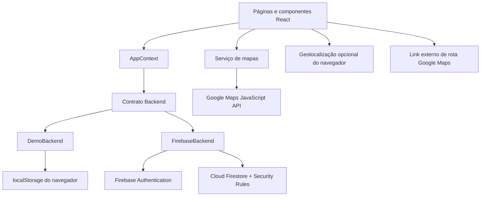

# Arquitetura do EcoDescarte

## Objetivo e decisões

O EcoDescarte é uma aplicação web de página única para orientar o descarte e conectar resíduos a pontos de coleta. A arquitetura prioriza execução simples, organização por responsabilidade e adaptação a um backend Firebase, sem exigir servidor próprio no MVP.

React e TypeScript compõem a apresentação. React Router resolve navegação e páginas. O contexto central disponibiliza dados, sessão, carregamento, erros e operações. Serviços implementam persistência e validações; utilitários concentram cálculos e formatação.

## Organização das responsabilidades

| Diretório        | Responsabilidade                                                          |
| ---------------- | ------------------------------------------------------------------------- |
| `src/pages`      | Páginas públicas, autenticação, perfil e administração                    |
| `src/components` | Navegação, cards, estados vazios, avisos e outros elementos reutilizáveis |
| `src/contexts`   | Estado compartilhado, sessão e encaminhamento das operações               |
| `src/services`   | Contrato de backend, persistência, validação e integração com mapas       |
| `src/config`     | Inicialização dos serviços e leitura das variáveis de ambiente            |
| `src/types`      | Modelos e interfaces TypeScript                                           |
| `src/utils`      | Busca, normalização, distância, níveis e estatísticas                     |
| `src/hooks`      | Comportamentos reutilizáveis, como geolocalização                         |
| `src/data`       | Catálogo inicial e base identificada de demonstração                      |
| `src/styles`     | Estilos, responsividade e estados de interação                            |
| `scripts`        | Operações de seed e administração com privilégios externos à interface    |
| `tests`          | Verificações automatizadas e cenários de integração                       |

O contrato `AppContextValue` define as operações consumidas pelas telas: autenticação, atualização de perfil, cadastro de material/ponto, sugestão, moderação, descarte, avaliação e pesquisa. As implementações de persistência compartilham o mesmo contrato. A interface não grava documentos diretamente.

## Modos de execução

### Demonstração local

Na ausência de configuração Firebase, a aplicação utiliza dados locais. O armazenamento tem a chave `ecodescarte-demo-v1`, uma versão de formato, catálogo, contas de teste e sessão. Recarregar a página mantém os registros nesse navegador. Apagar os dados do site remove esse histórico.

As contas demo de usuário e administrador permitem percorrer fluxos na apresentação. Cadastro e login locais usam derivação PBKDF2 com sal para evitar armazenamento da senha em texto puro. Isso não transforma o modo demo em autenticação confiável: toda a implementação e os dados são controlados pelo navegador. Somente dados de teste devem ser utilizados.

Os pontos locais são fictícios e rotulados como demonstração. A recuperação de senha informa que não envia e-mail; não simula entrega real. Dados locais não são migrados automaticamente para Firebase.

### Firebase

O SDK cliente utiliza Firebase Authentication para sessão e Cloud Firestore para documentos. Uma configuração parcial gera aviso de configuração em vez de fazer o usuário acreditar que está persistindo dados no servidor.

As configurações `VITE_*` fazem parte do bundle público do Vite. A configuração web do Firebase e a chave de navegador do Maps não são credenciais administrativas; sua proteção depende de regras, restrições de API e domínio. Chaves privadas de contas de serviço nunca devem usar o prefixo `VITE_` nem entrar no frontend ou no repositório.

Consulte o README e `.env.example` para os nomes finais das variáveis e os comandos de execução. A presença da integração no código não comprova autenticação, envio de e-mail ou leitura/escrita em um projeto remoto: esses fluxos precisam de um projeto configurado e de validação específica.

## Modelo de dados

Datas de criação e atualização são representadas como strings ISO nos modelos TypeScript. A data do descarte utiliza `YYYY-MM-DD`, preservando o dia informado. O limite de hoje usa America/Sao_Paulo no cliente e UTC−3 nas regras, que também validam o calendário e o ano mínimo de 2000.

| Coleção            | Campos relevantes                                                                            | Relacionamentos                                 |
| ------------------ | -------------------------------------------------------------------------------------------- | ----------------------------------------------- |
| `users`            | `name`, `email`, `role`, `photoURL`, `createdAt`                                             | ID associado ao usuário autenticado             |
| `wastes`           | `name`, `normalizedName`, `synonyms`, `category`, orientações, riscos, `active`              | Referenciada pelos pontos e descartes           |
| `collectionPoints` | Endereço, coordenadas, `acceptedWasteIds`, horários, `verified`, `active`, `demo`, avaliação | Lista de IDs de resíduos aceitos                |
| `suggestions`      | `userId`, endereço, materiais, `status`, análise e `pointId`                                 | Usuário autor; ponto gerado na aprovação        |
| `disposals`        | `userId`, `wasteId`, `collectionPointId`, `quantity`, `date`, `createdAt`                    | Usuário, resíduo e ponto compatível             |
| `reviews`          | `userId`, `pointId`, `rating`, `confirmed`, `comment`, `createdAt`                           | Uma avaliação por usuário e ponto               |
| `searchLogs`       | `term`, `wasteId`, `userId`, `createdAt`                                                     | Resíduo opcional; visitante tem `userId = null` |

O campo `demo` evita apresentar locais fictícios como estabelecimentos reais. O campo `verified` descreve a revisão cadastral, sem prometer certificação ambiental. Desativação preserva registros anteriores e evita a perda de referências no histórico.

## Fluxos de negócio

### Pesquisa e orientação

A busca normaliza caixa e acentos e consulta nomes e sinônimos. Correspondências exatas têm prioridade; em seguida vêm trechos e tolerância limitada a diferenças de grafia. Resíduos desativados não aparecem na busca pública. Sem resultado, a interface oferece uma mensagem e alternativas de navegação.

Uma pesquisa gera um evento simples para análise administrativa. Não há alegação de número de visitantes únicos, medição automática de reciclagem ou análise de perfil individual.

### Descarte

Um registro exige usuário autenticado, resíduo ativo, ponto ativo que receba esse resíduo, quantidade inteira positiva e data válida até o dia atual. A quantidade é apresentada em unidades; para líquidos, o formulário orienta contar recipientes. O valor não pode ser interpretado como peso, volume ou equivalência ambiental.

Cada registro gera 10 EcoPontos, independentemente da quantidade. O usuário não recebe pontos apenas por abrir uma orientação, uma rota ou um formulário. Registros são autorrelatados e não constituem comprovante de destinação.

### Sugestões

O envio cria uma sugestão `PENDENTE`. Ela aparece no histórico do autor e na moderação administrativa, sem ser publicada como ponto. O administrador informa coordenadas e aprova, ou registra um motivo e rejeita. O fluxo não permite reaprovar uma sugestão já analisada.

A aprovação vincula a sugestão ao novo ponto. O autor recebe 30 EcoPontos por aprovação. Não há pontuação para envio pendente ou rejeitado.

### Confirmações e avaliação

Uma confirmação associa usuário e ponto; o identificador composto evita duplicação da mesma contribuição. A avaliação usa estrelas de 1 a 5 e comentário opcional. O evento confirmado gera 5 EcoPontos. Trata-se de participação do usuário, não de auditoria independente dos dados do estabelecimento.

### EcoPontos

O saldo e o nível são calculados pelo histórico, sem aceitar um total editável do usuário:

`descartes do usuário × 10 + sugestões aprovadas do usuário × 30 + avaliações confirmadas do usuário × 5`

Os níveis começam em 0, 50, 150, 300 e 500 pontos. A barra exibe o progresso dentro da faixa atual até a próxima. EcoPontos são um incentivo de participação e não possuem valor financeiro.

## Autorização e segurança

A proteção de rota melhora a navegação, mas a autoridade de acesso em Firebase é a camada de Security Rules. Visitantes acessam dados públicos ativos; usuários escrevem apenas suas contribuições permitidas e editam campos autorizados do próprio perfil. Operações de catálogo e moderação exigem perfil administrativo.

O cadastro público cria usuários comuns. A concessão de administração ocorre por operação privilegiada fora do frontend. Alterar `role` em uma requisição cliente não deve permitir promoção de acesso. As regras também restringem campos, tipos, estados de análise e vínculos entre documentos.

O modo local possui verificações para demonstrar os mesmos fluxos, mas não oferece isolamento contra a pessoa que controla o navegador. Para implantação, as regras precisam ser publicadas e testadas no projeto de destino. Não se deve liberar o Firestore com regras abertas para contornar erros de permissão.

## Mapas, localização e privacidade

A API de mapas é carregada quando necessária e pode falhar sem remover o catálogo de pontos. Sem chave ou em erro, a interface oferece explicação e mantém a navegação pela lista. O navegador solicita localização somente após a ação do usuário; negar permissão não impede o uso dos filtros.

A distância calculada por coordenadas é aproximada, em linha reta, e não representa distância de trajeto ou previsão de viagem. A rota externa utiliza o destino do ponto e, quando disponível, a origem autorizada pelo usuário. Ao abrir o serviço externo, aplica-se a experiência e a política desse provedor.

As coordenadas pessoais não são gravadas no perfil nem em um histórico contínuo. Em uma operação pública, a política de privacidade deverá detalhar registros de pesquisa, retenção, atendimento aos titulares e os provedores utilizados.

## Qualidade, operação e limites

O frontend utiliza labels, mensagens de erro, feedback de processamento, foco visível, alternativas textuais e adaptação a telas menores. O objetivo é permitir concluir o fluxo principal por teclado e em dispositivos móveis; conformidade formal de acessibilidade requer auditoria própria.

A estratégia de verificação combina build TypeScript, testes das regras de negócio, percursos de interface e testes de regras do Firestore em emulador. O relatório de execução deve separar testes locais realmente realizados de integrações que dependem de credenciais, acesso externo ou infraestrutura não disponível.

O MVP mantém os dados acessíveis pelo contexto da aplicação e calcula relatórios sobre o conjunto carregado. Para maior escala, são necessárias paginação, agregações, controle de abuso, observabilidade e revisão de custos. A atualização de horários, veracidade dos pontos e orientações exige curadoria humana.

Firebase Storage não é necessário para o fluxo principal porque o MVP não depende de upload. Um backend de processamento assíncrono, aplicativo nativo, IA e notificações ficam fora do escopo inicial. A separação por contrato permite acrescentar capacidades quando houver necessidade demonstrada.

## Evidências de execução

Os testes executados e seus limites estão registrados em [TESTES.md](TESTES.md). O serviço Firebase foi exercitado com Authentication e Firestore emulados; publicação remota e Google Maps autenticado continuam condicionados à configuração externa.
